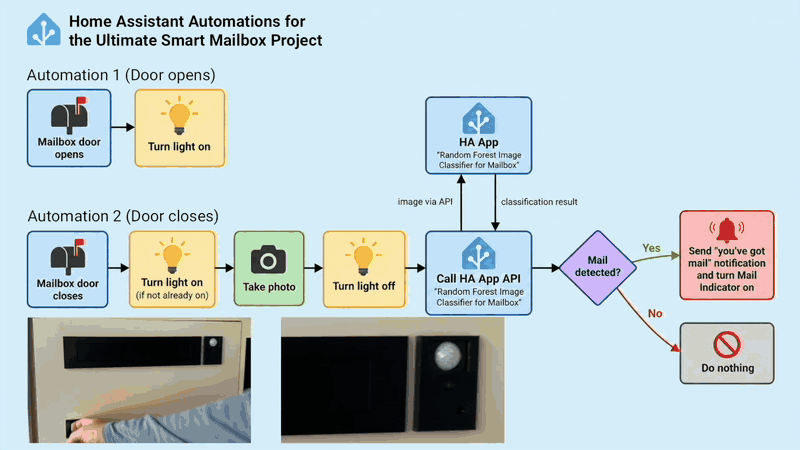

# Image Classifier RFHOG
by Smart Home Rewired, Oct 2026

**A lightweight, fully local image-classification Home Assistant App, that can be used to classify images from within an automation.**

In this sample use case the classifier is used to evaluate images taken inside a mailbox triggered by an Home Assistant automation, to determine if the mailbox contains mail.

The classifier combines **Histogram of Oriented Gradients (HOG)** with color and image-statistics features and a **Random Forest classifier (RF)**. 

Training and evaluation is done in a Jupyter notebook (see [training/image_classifier_rfhog_training/image_classifier_rfhog_training.ipynb](training/image_classifier_rfhog_training/image_classifier_rfhog_training.ipynb)), and the trained model can be deployed as a local **Home Assistant App** and called directly from Home Assistant automations.

The project was built as part of a larger Smart Mailbox system using ESP32-CAM components, Home Assistant, Frigate, a Synology NAS, and Apple HomeKit. (see ▶️ [see the Youtube Series "Ultimate Smart Mailbox" part 1, 2, 3](https://www.youtube.com/channel/UChWTRp5MhretkMP-LKyA5-A))



This animation shows the flow of two Home Assistant mailbox automations: ‘Door opens’ and ‘Door closes.’ The complete YAML files are available in the [Home Assistant Configuration](../../Home%20Assistant%20Configuration/) folder.

---

## What it does

A camera mounted inside the mailbox captures an image whenever mail may have been delivered (triggered by the mailbox door being closed). The classifier predicts one of two classes:

- `empty`
- `occupied`

When deployed in Home Assistant, the result can be used to:

- send a photo notification
- switch on a mailbox status LED
- update a dashboard
- trigger another automation
- archive images for future retraining

Typical flow Automation "Mail door opens":

```text
Mailbox door / mail slot opens
              │
              ▼
     Turn mailbox LED on
```


Typical flow Automation "Mail door closes":

```text
Mailbox door / mail slot closes
              │
              ▼
     Turn mailbox LED on
              │
              ▼
     Home Assistant snapshot
              │
              ▼
     Turn mailbox LED off
              │
              ▼
      Image Classifier RFHOG App
              │
              ▼
       HOG + color features
              │
              ▼
         Random Forest
              │
              ▼
      empty / occupied
              │
       ┌──────┴──────┐
       ▼             ▼
 Notification     Status LED
```

---

## Why HOG + Random Forest?

The mailbox is a relatively controlled environment:

- the camera position is fixed
- the viewing angle is fixed
- the background changes relatively little
- the classification task is binary

This makes traditional computer-vision features a good fit.

**HOG** captures local edges and shape changes. Color histograms and global image statistics add information about brightness and color distribution.

The **Random Forest** combines those features to distinguish an empty mailbox from letters, newspapers, parcels, and other objects.

This approach is lightweight, fast, fully local, and does not require cloud inference or a GPU or lots of RAM.

---

# Repository structure

```text
smart-home-rewired / Project 2 - Ultimate Mailbox/AI Package Detection / Image Classification /
│
├── training/image_classifier_rfhog_training/
│   └── image_classifier_rfhog_training.ipynb # use this script to train your model based on your own images
│   └── requirements-training.txt # use this environment for training
│
├── models/
│   └── mailbox_rfhog.joblib        # created after training
│   └── mailbox_rfhog_metadata.json # auto generated, based on the last training run
│
├── home-assistant-apps/
│   └── image_classifier_rfhog/   # this is the app to be installed in Home Assistant
│       ├── config.yaml
│       ├── Dockerfile
│       ├── app.py
│       ├── run.sh
│       └── requirements.txt
│       └── README.md
│       └── DOCS.md
│       ├── images/
│       │   └── mailalgo_final_updated.gif # animated gif to show flow within automations for sample use case
│
└── README.md
```

The important separation is:

- `training/` contains the training pipeline
- DATASET_DIR contains labeled training images (to be setup in the training script)
- `home-assistant-apps/image_classifier_rfhog/` contains the runtime service used inside Home Assistant

---

# 1. Development setup

If you follow these instructions, please also look at, for additional information.
├── home-assistant-apps/
│   └── image_classifier_rfhog/  
│       └── README.md
│       └── DOCS.md


## Requirements

For training:

- Python 3
- Visual Studio Code or Jupyter Notebook or JupyterLab
- NumPy
- Pillow
- scikit-image
- scikit-learn
- joblib
- pandas
- matplotlib

For Home Assistant deployment:

- Home Assistant OS or another installation that supports local Apps/add-ons
- the App files from `home-assistant-apps/image_classifier_rfhog/`

Optional:

- Home Assistant Samba Share for convenient file access - see Home Assistant --> Apps --> Install "Samba Share"
- NAS/network storage
- Frigate # used to stabilize video stream - only needed for Apple Homekit integration in this project
- ESP32-CAM or another camera source

---

## Create a virtual environment

Clone the repository:

```bash
git clone https://github.com/pbreuss/smart-home-rewired.git
cd smart-home-rewired/Project\ 2\ -\ Ultimate\ Mailbox/AI\ Package\ Detection/Image\ Classification/
```

Create and activate a virtual environment:

```bash
python3 -m venv mailbox_classifier_venv
source mailbox_classifier_venv/bin/activate
```

On Windows:

```powershell
mailbox_classifier_venv\Scripts\activate
```

Install dependencies:

```bash
pip install -r requirements.txt

cd training/image_classifier_rfhog_training
pip install -r requirements-training.txt
```

The virtual environment itself should not be committed to Git.

---

# 2. Prepare the dataset

Place training images into two class folders:

```text
mailbox_dataset/
├── empty/
│   ├── empty_001.jpg
│   ├── empty_002.jpg
│   └── ...
│
└── occupied/
    ├── letter_001.jpg
    ├── parcel_001.jpg
    ├── newspaper_001.jpg
    └── ...
```

`empty/` contains images where nothing is inside the mailbox.

`occupied/` contains images with letters, newspapers, parcels, or other delivered objects.

For a useful real-world model, collect varied examples:

- large and small parcels
- white and colored envelopes
- newspapers
- objects in different positions
- different daylight conditions
- LED illumination
- shadows and reflections

Difficult examples are especially valuable. For example, a white envelope on a bright mailbox floor may be much harder to detect than a large brown parcel.

Try to keep both classes reasonably balanced.

---

# 3. Train the classifier

Training is performed in:

```text
training/image_classifier_rfhog_training/image_classifier_rfhog_training.ipynb
```

Start Jupyter from the repository root:

```bash
jupyter notebook
```

Open:

```text
train/image_classifier_rfhog_training/image_classifier_rfhog_training.ipynb
```

and run the cells in sequence.

The notebook performs the complete training pipeline:

1. load labeled mailbox images
2. preprocess the images
3. extract HOG features
4. extract color and image-statistics features
5. train a Random Forest classifier
6. evaluate the classifier
7. inspect classification errors
8. save the trained model

For this use case, the most important error is a **false empty**:

> The mailbox contains something, but the classifier predicts `empty`.

For that reason, do not rely on training accuracy alone. Cross-validation, the confusion matrix, occupied-class recall, and the false-empty count are more useful.

---

# 4. Feature pipeline

The training notebook and deployed classifier must use **exactly the same feature extraction pipeline**.

The current pipeline includes:

## Color and image statistics

- RGB histograms
- HSV histograms
- grayscale histogram
- RGB mean and standard deviation
- grayscale mean and standard deviation
- simple edge-density measurement

## HOG

Typical parameters:

```text
HOG image:        160 × 120
Orientations:     9
Pixels per cell:  8 × 8
Cells per block:  2 × 2
Normalization:    L2-Hys
```

If you change feature extraction during training, make the same change in the Home Assistant App before deploying the newly trained model.

---

# 5. Save the trained model

After training, the notebook creates:

```text
mailbox_rfhog.joblib
```

For local development, place it in:

```text
models/mailbox_rfhog.joblib
```

The `.joblib` file contains the trained Random Forest model used for inference.

Model training and App deployment are intentionally separated. You can retrain and replace the model without rebuilding the App, as long as the feature pipeline remains compatible.

---

# 6. Home Assistant deployment

As described in the beginning of this [Home Assistant tutorial](https://developers.home-assistant.io/docs/apps/tutorial), use Samba Share to access the directory of your Home Assistant installation. In the Finder (Mac OS) or File Explorer (Windows), find the directory /media. Create the following subdirectories within /media.

```text
/media/
├── image_classifier_rfhog/
│   ├── mailbox_rfhog.joblib   # This will be your trained classifier model
│   └── reference_image/       # Test images: at least one empty and one occupied
│
└── mailbox_dataset/
    ├── current/               # All snapshots are initially saved here
    ├── empty/                 # Images classified as an empty mailbox
    └── occupied/              # Images classified as containing mail or a package
```


Choose one of the following installation methods.

## Option A — Install using the repository URL (recommended)

1. In Home Assistant, go to **Settings → Apps → Install App**.
2. Open the **⋮ menu → Repositories**.
3. Add this repository URL:

   ```text
   https://github.com/pbreuss/smart-home-rewired
   ```

4. Close the repository dialog and refresh the App store if necessary.
5. Find **Image Classifier RFHOG** under **Smart Home Rewired** and click **Install**.

Use the repository’s root URL, rather than a link to an individual App folder. This method lets Home Assistant offer updates when new App versions are published.

## Option B — Install manually as a local App

Download or clone the repository. Inside the **Image Classification** directory, copy this complete folder:

```text
home_assistant_apps/image_classifier_rfhog_ha_app/
```

Place it in Home Assistant’s local `/addons/` directory.

```text
/addons/image_classifier_rfhog/
├── config.yaml
├── Dockerfile
├── app.py
├── run.sh
├── requirements.txt
└── ...
```

You can copy the folder using the **Samba Share** App.

Do not copy only `app.py`. Home Assistant needs the complete directory to build and run the App.

After copying:

1. Go to **Settings → Apps → Install App**.
2. Select **Check for updates** from the **⋮ menu**.
3. Find **Image Classifier RFHOG** under **Local apps** and click **Install**.

For future updates, replace the local source files and rebuild the App.

## After installation

Configure the model and image paths in the App’s **Configuration** tab, then start the App.

The internal hostname depends on your installation method. With `slug: image-classifier-rfhog`, use:

- **Repository installation:** `http://32878c6d-image-classifier-rfhog:8098/classify`
- **Manual local installation:** `http://local-image-classifier-rfhog:8098/classify`

Use the corresponding URL in your Home Assistant REST command - when editing configuration.yaml.

---

## Access `/addons` from macOS with Samba

A convenient method is the Home Assistant **Samba Share** App.

In Finder:

1. press **⌘ K**
2. enter:

```text
smb://<HOME_ASSISTANT_IP>
```

3. authenticate with the credentials configured in Samba Share
4. open the `addons` share
5. copy the `image_classifier_rfhog` folder into it

Example only:

```text
smb://192.168.0.182
```

Replace that address with the IP address of your own Home Assistant installation.

---

# 7. Configure the App

For a model stored on NAS/network storage:

```yaml
options:
  model_path: "/media/mailbox_rfhog.joblib"
  default_image: "/media/current_mailbox.jpg"
```

The App also needs access to Home Assistant's media directory (so this setting needs to be in config.yaml):

```yaml
map:
  - media:rw
```

---

# 8. Verify the classifier

Open the Image Classifier RFHOG App in Home Assistant.

The status page should report that the model was loaded successfully.

For example:

```text
Model: /media/mailbox_rfhog.joblib
Status: model loaded
```

The App also exposes:

```text
GET /health
```

A successful response looks similar to:

```json
{
  "ok": true,
  "classifier": "hog_color_random_forest",
  "model_loaded": true,
  "model_path": "/media/frigate/mailbox_rfhog.joblib"
}
```

---

# 9. Classifier API

The main endpoint is:

```text
POST /classify
```

Request:

```json
{
  "image": "/media/current_mailbox.jpg"
}
```

Typical response:

```json
{
  "ok": true,
  "classifier": "hog_color_random_forest",
  "prediction": "occupied",
  "occupied_probability": 0.94,
  "empty_probability": 0.06
}
```

The App also supports:

```text
GET /health
POST /reload
```

`POST /reload` reloads the model from disk without rebuilding the App.

---

# 10. Connect the App to Home Assistant

Add a REST command to Home Assistant's `configuration.yaml`:

```yaml
rest_command:
  image_classifier_rfhog:
    url: "http://32878c6d-image-classifier-rfhog:8098/classify"
    method: POST
    content_type: "application/json"
    payload: >
      {
        "image": "{{ image }}"
      }
``` 

If `configuration.yaml` already contains a `rest_command:` section, add `image_classifier_rfhog:` below the existing commands instead of creating a second `rest_command:` section.

Restart Home Assistant after changing `configuration.yaml`.

> Depending on how the local App is named in your Home Assistant installation, the internal hostname may differ. If the request cannot connect, check the App hostname/network information and use that hostname instead. See "After installation".

---

# 11. Call the classifier from an automation

Take a snapshot first:

```yaml
- variables:
    timestamp: "{{ now().strftime('%Y%m%d_%H%M%S') }}"
    current_image: "/media/frigate/mailbox_dataset/current/mailbox_{{ timestamp }}.jpg"

- action: camera.snapshot
  target:
    entity_id: camera.your_mailbox_camera
  data:
    filename: "{{ current_image }}"
```

Then classify this image:

```yaml
- action: rest_command.image_classifier_rfhog
  data:
    image: "{{ current_image }}"
  response_variable: classifier_result
```

Extract the result:

```yaml
- variables:
    rf_prediction: "{{ classifier_result.content.prediction }}"
    rf_occupied_probability: >-
      {{ classifier_result.content.occupied_probability | float }}
    rf_occupied_percent: >-
      {{ (classifier_result.content.occupied_probability | float * 100) | round(1) }}
```

You can now react to:

```text
empty
```

or:

```text
occupied
```

Example:

```yaml
- choose:
    - conditions:
        - condition: template
          value_template: "{{ rf_prediction == 'occupied' }}"
      sequence:
        - action: notify.notify
          data:
            title: "Mailbox"
            message: >
              Mailbox occupied probability:
              {{ rf_occupied_percent }} %
```

---

# 12. Archive classified images

Keeping classified images is useful because they become new training data.

For example:

```text
mailbox_dataset/
├── current/
├── empty/
└── occupied/
```

A Home Assistant automation can archive each image into the predicted class.

Later, incorrect classifications can be moved to the correct folder before retraining.

This creates a practical feedback loop:

```text
Run classifier
      ↓
Archive image
      ↓
Review difficult / wrong examples
      ↓
Correct labels
      ↓
Retrain
      ↓
Deploy improved model
```

---

# 13. Updating the model after retraining

One of the main benefits of this architecture is that retraining does not require rebuilding the App.

Train a new model and replace the existing `.joblib`.

For example, on a Mac with the NAS mounted:

```text
/media/
├── image_classifier_rfhog/
│   ├── mailbox_rfhog.joblib   
```

Then either restart the Image Classifier RFHOG App or call:

```text
POST /reload
```

The new model becomes active immediately.

In short:

```text
Change Python/App code
        ↓
Rebuild/update Home Assistant App

Retrain Random Forest
        ↓
Replace mailbox_rfhog.joblib
        ↓
Reload model
```

---

# 16. Troubleshooting

## App does not appear in Home Assistant

Check that the directory is exactly:

```text
/addons/image_classifier_rfhog/
```

and contains at least:

```text
config.yaml
Dockerfile
app.py
run.sh
requirements.txt
```

Then reload the App Store.

---

## Model not found

Check the configured model path:

```yaml
model_path: "/media/mailbox_rfhog.joblib"
```

or:

```yaml
model_path: "/data/mailbox_rfhog.joblib"
```

Then call:

```text
GET /health
```

and inspect the App logs.

---

## Image not found

The path passed to `/classify` must be visible **inside the App container**.

For images stored under Home Assistant media storage, make sure the App has:

```yaml
map:
  - media:rw
```

and pass a path such as:

```text
/media/current_mailbox.jpg
```

or:

```text
/media/frigate/mailbox_dataset/current/mailbox_20260917_120000.jpg
```

---

## Model loads but classification fails

The most common cause is a mismatch between the feature pipeline used during training and the feature pipeline used by the App.

The following must match:

- image preprocessing
- resize dimensions
- histogram settings
- HOG parameters
- feature order
- number of features

The safest approach is to keep the training and inference `extract_features()` implementation identical.

---

# 17. Security and privacy

All classification can run locally.

No mailbox images need to be uploaded to a cloud service.

Depending on your Home Assistant setup, images, model files, and predictions can stay entirely within your local network.

---

# 18. Ideas for further development

Possible extensions include:

- probability-threshold tuning
- HOG-only vs. HOG+color comparison
- automatic hard-example collection
- model versioning
- confidence logging
- MobileNetV3Small comparison
- per-class performance dashboards
- Home Assistant sensors for classifier confidence
- automatic retraining pipelines
- multi-camera support

---

# License

The original code and configuration files in this repository are
licensed under the [MIT License](LICENSE).

You are welcome to use, modify, and share them for your own projects,
including commercial projects. Please retain the copyright and
license notice.

The software is provided without warranty. Third-party software,
logos, and other assets remain subject to their respective licenses.

---

# Acknowledgements

Built as part of a DIY Smart Mailbox project combining embedded hardware, local computer vision, Home Assistant automation, and edge-friendly machine learning.
